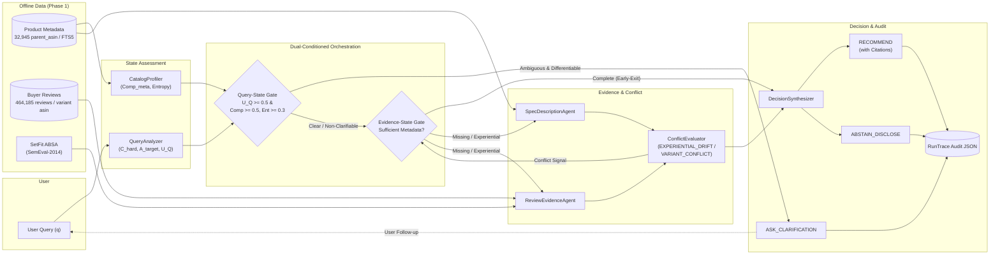

# Dual-State Adaptive Multi-Agent System for Online Shopping Decision Support

An offline research prototype of a **Dual-Conditioned Adaptive Multi-Agent System (MAS)** for high-consideration e-commerce decision-making in the **Laptop** domain. Instead of routing purely on query complexity or executing a fixed sequential pipeline, the system jointly tracks:

1. **Query State (`S_Q`)**: user intent, explicit hard constraints (`C_hard`), target attributes (`A_target`), and per-attribute query ambiguity (`U_Q`).
2. **Catalog & Evidence State (`S_E`)**: candidate metadata completeness (`Comp_meta`), normalized attribute value entropy (`Entropy`), recoverable buyer review evidence, and cross-source conflict signals (`EXPERIENTIAL_DRIFT` and `VARIANT_CONFLICT`).

By conditioning orchestration on both states simultaneously, the system chooses when to **ask a grounded clarification**, **early-exit with a cited recommendation**, **escalate to specialized evidence agents**, or **abstain/disclose evidence limitations**—preventing unanswerable clarification questions (*Probe Waste*) and unsupported product claims.

---

## Table of Contents

- [Overview](#overview)
- [System Architecture](#system-architecture)
  - [Execution Loop & Routing Gates](#execution-loop--routing-gates)
  - [Core Components](#core-components)
- [Repository Structure & Module Directory](#repository-structure--module-directory)
- [Prerequisites & Input Requirements](#prerequisites--input-requirements)
  - [Software Requirements](#software-requirements)
  - [Required Input Datasets](#required-input-datasets)
- [Installation](#installation)
- [Usage by Phase](#usage-by-phase)
  - [Phase 1: Data Preparation & SetFit ABSA Training](#phase-1-data-preparation--setfit-absa-training)
  - [Phase 2: Dual-Conditioned MAS Pipeline & Routing Calibration](#phase-2-dual-conditioned-mas-pipeline--routing-calibration)
  - [Phase 3: Multi-System Benchmark with Local LLM & Simulated Users](#phase-3-multi-system-benchmark-with-local-llm--simulated-users)
  - [Phase 4: Human Annotation Workbook & Statistical Analysis Tooling](#phase-4-human-annotation-workbook--statistical-analysis-tooling)
- [Testing](#testing)
- [Data Sources & Citations](#data-sources--citations)
- [License](#license)

---

## Overview

Conventional multi-agent shopping assistants either invoke every specialist agent sequentially (incurring unnecessary latency and token overhead on simple queries) or route solely based on input query text while assuming the product catalog is complete and conflict-free. In real-world e-commerce catalogs, technical specifications are frequently incomplete across product variants (`asin`) or contradicted by buyer experiences in reviews.

This repository implements a 4-phase experimental framework:

- **[Phase 1](./scripts/phase1/README.md)**: Streaming normalization of Amazon Reviews 2023 (Laptops subset) and CHIIR '21 `VACOS_NLQ` queries, plus training and packaging a SetFit Aspect-Based Sentiment Analysis (ABSA) model on SemEval-2014 Laptop Reviews.
- **[Phase 2](./scripts/phase2/README.md)**: Implementation of the 6-step Dual-Conditioned Adaptive MAS (`Analyze → Retrieve → Assess → Route → Verify → Decision`) and threshold calibration across four query-catalog strata (`S1`–`S4`).
- **[Phase 3](./scripts/phase3/README.md)**: End-to-end evaluation comparing five architectures (`B1`–`B4` and `Ours`) using a local Ollama LLM (`llama3:latest`) and review-grounded simulated users over frozen evaluation cases.
- **[Phase 4](./scripts/phase4/README.md)**: Tooling to export multi-system responses into a structured Excel workbook with an embedded grading rubric for human expert annotation, plus post-annotation QA and paired exact McNemar statistical tests.

---

## System Architecture



### Execution Loop & Routing Gates

1. **Query-State Gate (`QueryAnalyzer` + `CatalogProfiler` → `AdaptiveOrchestrator`)**:
   - Evaluates per-attribute ambiguity `U_Q(a)` alongside candidate metadata coverage `Comp_meta(a)` and normalized value entropy `Entropy(a)`.
   - Triggers `ASK_CLARIFICATION` **only** when an attribute is ambiguous (`U_Q >= 0.5`), well-covered in candidate metadata (`Comp_meta >= 0.5`), and sufficiently diverse across candidates (`Entropy >= 0.3`). If catalog data cannot differentiate products on that attribute, clarification is suppressed to prevent *Probe Waste*.
2. **Evidence-State Gate (`AdaptiveOrchestrator`)**:
   - **Early-Exit**: When explicit constraints and target attributes are already satisfied by structured catalog metadata, the orchestrator bypasses review scanning and routes directly to `DecisionSynthesizer`.
   - **Evidence Escalation**: When target specifications are missing in metadata or require experiential verification, the orchestrator dispatches `SpecDescriptionAgent` and `ReviewEvidenceAgent`.
3. **Conflict Feedback & Decision Synthesis (`ConflictEvaluator` → `DecisionSynthesizer`)**:
   - Detects majority negative buyer sentiment contradicting listed specs (`EXPERIENTIAL_DRIFT`) and diverging sentiment across variant ASINs under the same `parent_asin` (`VARIANT_CONFLICT`).
   - Synthesizes one of four terminal actions: `ASK_CLARIFICATION`, `ACTIVATE_EVIDENCE_AGENTS`, `RECOMMEND` (with source-linked citations), or `ABSTAIN_DISCLOSE` (when evidence is missing or irreconcilably conflicted).

### Core Components

| Component | Source File | Responsibility |
|---|---|---|
| **Amazon Data Pipeline** | [`scripts/phase1/prepare_amazon.py`](./scripts/phase1/prepare_amazon.py) | Streams `meta_Electronics.jsonl` and `review_Electronics.jsonl.gz`, filters laptop `parent_asin` records, links variant reviews, and computes keyword coverage. |
| **VACOS Query Pipeline** | [`scripts/phase1/prepare_vacos_queries.py`](./scripts/phase1/prepare_vacos_queries.py) | Extracts laptop natural language queries from `VACOS_NLQ_v2`, preserving key-fact BIO tags and vague-span BIO annotations. |
| **SetFit ABSA Trainer** | [`scripts/phase1/train_setfit_absa.py`](./scripts/phase1/train_setfit_absa.py) | Fine-tunes `paraphrase-mpnet-base-v2` on SemEval-2014 laptop aspect-sentiment pairs using a grouped stratified validation split. |
| **Review ABSA Agent** | [`scripts/phase1/review_absa_agent.py`](./scripts/phase1/review_absa_agent.py) | Combines spaCy sentencizer + `PhraseMatcher` aspect extraction with SetFit inference to produce offset-linked review evidence. |
| **Query Analyzer** | [`scripts/phase2/query_analyzer.py`](./scripts/phase2/query_analyzer.py) | Parses hard numeric constraints (RAM, storage, display size, USD price, battery runtime, weight), target attributes, and uncertainty scores `U_Q`. |
| **Catalog Profiler** | [`scripts/phase2/catalog_profiler.py`](./scripts/phase2/catalog_profiler.py) | Retrieves candidates via SQLite FTS5, filters hard constraints, extracts specs, and computes completeness and normalized Shannon entropy. |
| **Adaptive Orchestrator** | [`scripts/phase2/orchestrator.py`](./scripts/phase2/orchestrator.py) | Implements the dual-conditioned routing gates (`Query-State Gate` and `Evidence-State Gate`) and manages agent dispatch. |
| **Evidence Agents** | [`scripts/phase2/evidence_agents.py`](./scripts/phase2/evidence_agents.py) | `SpecDescriptionAgent` (metadata extraction) and `ReviewEvidenceAgent` (bounded review stream scanning + SetFit ABSA). |
| **Conflict Evaluator** | [`scripts/phase2/conflict_evaluator.py`](./scripts/phase2/conflict_evaluator.py) | Identifies `EXPERIENTIAL_DRIFT` and `VARIANT_CONFLICT` across metadata and variant-level review evidence. |
| **Decision Synthesizer** | [`scripts/phase2/decision_synthesizer.py`](./scripts/phase2/decision_synthesizer.py) | Produces final grounded decisions (`ASK_CLARIFICATION`, `RECOMMEND`, `ABSTAIN_DISCLOSE`) and records audit traces (`RunTrace`). |
| **Phase 2 Evaluator** | [`scripts/phase2/evaluate.py`](./scripts/phase2/evaluate.py) | Calibrates routing thresholds using precision-weighted `F0.5` and evaluates routing behavior across strata `S1`–`S4`. |
| **Phase 3 Benchmark** | [`scripts/phase3/benchmark.py`](./scripts/phase3/benchmark.py) | Evaluates 5 systems (`B1`–`B4`, `Ours`) with local Ollama generation ([`ollama_client.py`](./scripts/phase3/ollama_client.py)) and review-grounded [`simulated_users.py`](./scripts/phase3/simulated_users.py). |
| **Phase 4 Annotation Tools** | [`scripts/phase4/prepare_annotation_workbook.py`](./scripts/phase4/prepare_annotation_workbook.py) | Exports Phase 3 benchmark outputs to an Excel annotation workbook and analyzes completed human labels ([`analyze_annotations.py`](./scripts/phase4/analyze_annotations.py)). |

---

## Repository Structure & Module Directory

```text
dual-state-shopping-mas/
├── README.md                                      # Main project documentation & architecture guide
├── requirements.txt                               # Python dependencies for pipeline, training, and tests
├── .gitignore                                     # Excludes datasets, weights, reports, and annotation files
├── scripts/
│   ├── phase1/                                    # Phase 1: Offline data preparation & SetFit ABSA
│   │   ├── README.md                              # Phase 1 detailed guide
│   │   ├── prepare_amazon.py                      # Amazon Reviews 2023 laptop catalog & review linker
│   │   ├── prepare_vacos_queries.py               # CHIIR '21 VACOS_NLQ v2 query & BIO normalizer
│   │   ├── train_setfit_absa.py                   # SetFit ABSA training & grouped validation
│   │   └── review_absa_agent.py                   # Aspect span extractor & SetFit inference wrapper
│   ├── phase2/                                    # Phase 2: Dual-Conditioned Adaptive MAS
│   │   ├── README.md                              # Phase 2 detailed guide
│   │   ├── __main__.py                            # CLI entrypoint for single-query inference
│   │   ├── types.py                               # Dataclasses for states, evidence, conflicts, and traces
│   │   ├── query_analyzer.py                      # Hard-constraint & query ambiguity analyzer
│   │   ├── catalog_profiler.py                    # FTS5 candidate retrieval, completeness & entropy profiler
│   │   ├── orchestrator.py                        # Dual-gated adaptive orchestrator
│   │   ├── evidence_agents.py                     # SpecDescriptionAgent & ReviewEvidenceAgent
│   │   ├── conflict_evaluator.py                  # Cross-source & cross-variant conflict detector
│   │   ├── decision_synthesizer.py                # Grounded decision synthesis & citation formatter
│   │   └── evaluate.py                            # Threshold calibration & 4-strata routing evaluation
│   ├── phase3/                                    # Phase 3: Multi-system benchmark & user simulation
│   │   ├── README.md                              # Phase 3 detailed guide
│   │   ├── ollama_client.py                       # Loopback-only HTTP client for local Ollama LLM
│   │   ├── simulated_users.py                     # Review-grounded synthetic user personas
│   │   └── benchmark.py                           # 5-system comparative benchmark over frozen S1-S4 cases
│   └── phase4/                                    # Phase 4: Expert annotation & statistical analysis tooling
│       ├── README.md                              # Phase 4 detailed guide
│       ├── prepare_annotation_workbook.py         # Excel workbook & rubric generator (400 response rows)
│       └── analyze_annotations.py                 # Annotation QA validator & paired exact McNemar tests
└── tests/                                         # Unit test suite (runs without external data or Ollama)
    ├── test_phase1_data.py
    ├── test_review_absa_agent.py
    ├── test_phase2_system.py
    ├── test_phase2_evaluation.py
    ├── test_phase3.py
    ├── test_phase4_annotation.py
    └── test_phase4_analysis.py
```

---

## Prerequisites & Input Requirements

### Software Requirements

- **Operating System**: Windows, macOS, or Linux.
- **Python**: Python `3.12+` recommended.
- **Local LLM Service (Phase 3 only)**: [Ollama](https://ollama.com/) running locally on loopback (`http://localhost:11434`) with the `llama3:latest` model pulled.

### Required Input Datasets

Raw datasets, processed artifacts, and trained model weights are **not tracked in Git** due to size and redistribution terms. Download the source datasets from their official providers and place them at the default paths below (or pass custom paths via CLI flags):

| Source Dataset | Expected Local Path | Description & Role |
|---|---|---|
| **Amazon Reviews 2023 (Electronics Metadata)** | `dataset/amazon-review/meta_Electronics.jsonl` | Raw product metadata JSONL (~1.61M Electronics items; filtered to 32,945 laptop `parent_asin` rows). |
| **Amazon Reviews 2023 (Electronics Reviews)** | `dataset/amazon-review/review_Electronics.jsonl.gz` | Gzipped buyer review stream (~43.89M reviews; filtered to 464,185 linked laptop reviews preserving variant `asin`). |
| **CHIIR '21 VACOS_NLQ v2** | `dataset/chiir21_naturallanguagequeries/VACOS_NLQ_v2/VACOS_NLQ_data.json` | Natural language e-commerce queries with key-fact BIO tags and vague-word span annotations (1,695 laptop queries). |
| **SemEval-2014 Laptop ABSA** | `dataset/semeval/` | Hugging Face `DatasetDict` saved via `load_dataset('tomaarsen/setfit-absa-semeval-laptops').save_to_disk('dataset/semeval')`. |

---

## Installation

From the repository root:

```powershell
python -m venv .venv
.\.venv\Scripts\Activate.ps1
python -m pip install --upgrade pip
python -m pip install -r requirements.txt
```

Verify the installation by running the offline unit test suite:

```powershell
python -m unittest discover -s tests -v
```

---

## Usage by Phase

### Phase 1: Data Preparation & SetFit ABSA Training

Detailed documentation: [`scripts/phase1/README.md`](./scripts/phase1/README.md)

1. **Filter Amazon Laptop metadata and link reviews by `parent_asin`**:
   ```powershell
   python -m scripts.phase1.prepare_amazon
   ```
   Outputs are written to `dataset/processed/amazon-laptops/` (`laptops_catalog.jsonl`, `laptop_parent_asins.txt`, `laptops_reviews.jsonl.gz`, and `catalog_coverage.json`).

2. **Normalize VACOS laptop queries and BIO annotations**:
   ```powershell
   python -m scripts.phase1.prepare_vacos_queries
   ```
   Outputs `dataset/processed/vacos_laptops_bio.jsonl` and `dataset/processed/vacos_laptops_bio.summary.json`.

3. **Download SemEval-2014 dataset and train the SetFit ABSA classifier**:
   ```powershell
   python -c "from datasets import load_dataset; ds = load_dataset('tomaarsen/setfit-absa-semeval-laptops'); ds.save_to_disk('dataset/semeval')"
   python -m scripts.phase1.train_setfit_absa
   ```
   Saves the trained SetFit model and validation metrics to `models/setfit-absa-laptops/`.

4. **(Optional) Run standalone Review ABSA extraction over filtered reviews**:
   ```powershell
   python -m scripts.phase1.review_absa_agent
   ```

---

### Phase 2: Dual-Conditioned MAS Pipeline & Routing Calibration

Detailed documentation: [`scripts/phase2/README.md`](./scripts/phase2/README.md)

1. **Run single-query inference**:
   ```powershell
   python -m scripts.phase2 "laptop with at least 16 GB RAM under 1000 USD"
   ```
   Prints a JSON `RunTrace` containing parsed constraints, per-attribute uncertainty, catalog completeness and entropy, selected orchestration route, extracted citations/conflicts, and the synthesized decision.

2. **Run threshold calibration and 4-strata (`S1`–`S4`) routing evaluation**:
   ```powershell
   python -m scripts.phase2.evaluate --sample-size 160 --seed 42
   ```
   Sweeps uncertainty, coverage, and entropy thresholds on the calibration split (optimizing precision-weighted `F0.5`) and evaluates routing compliance on held-out queries across:
   - `S1` (Clear Query, Complete Catalog → Early-Exit Recommend)
   - `S2` (Ambiguous Query, Differentiable Catalog → Grounded Clarification)
   - `S3` (Clear Query, Masked/Missing Metadata → Evidence Agent Escalation)
   - `S4` (Ambiguous Query, Masked/Missing Metadata → Zero Probe-Waste & Safe Abstain/Disclose)

---

### Phase 3: Multi-System Benchmark with Local LLM & Simulated Users

Detailed documentation: [`scripts/phase3/README.md`](./scripts/phase3/README.md)

Ensure Ollama is running locally and pull the target model:

```powershell
ollama pull llama3:latest
```

Run the comparative benchmark across all five systems (`B1` Single LLM, `B2` Single-Agent ReAct Retrieval, `B3` Fixed Sequential MAS, `B4` Query-Adaptive MAS, and `Ours` Dual-Conditioned MAS):

```powershell
python -m scripts.phase3.benchmark --sample-size 160 --cases-per-stratum 20 --seed 42
```

Writes frozen case manifests and benchmark outputs to `reports/phase3/` (`phase3_frozen_cases.jsonl`, `phase3_baseline_results.json`, and `phase3_baseline_summary.csv`).

---

### Phase 4: Human Annotation Workbook & Statistical Analysis Tooling

Detailed documentation: [`scripts/phase4/README.md`](./scripts/phase4/README.md)

1. **Generate the Excel annotation workbook from Phase 3 results**:
   ```powershell
   python -m scripts.phase4.prepare_annotation_workbook
   ```
   Produces `reports/phase4/phase4_annotation.xlsx` containing 400 system-case rows (80 cases × 5 systems), an embedded **Annotation Rubric** sheet, and automatic summary formulas for Constraint Satisfaction Rate (CSR), Recommendation Coverage, Unsupported-Claim Rate (UCR), Evidence Grounding Precision (EGP), Probe-Waste Rate (PWR), Disambiguation Success, Abstention Quality, and Conflict Disclosure.

2. **Analyze completed human annotations and run paired statistical tests**:
   ```powershell
   python -m scripts.phase4.analyze_annotations --input reports/phase4/phase4_annotation_completed.csv
   ```
   Performs structural QA validation and computes paired per-stratum exact McNemar tests with Holm-Bonferroni correction.

---

## Testing

All unit tests are deterministic and execute offline without requiring raw datasets, trained SetFit weights, or a running Ollama server:

```powershell
python -m unittest discover -s tests -v
```

---

## Data Sources & Citations

- **Amazon Reviews 2023**: Hou et al., *Bridging Language and Items for Retrieval and Recommendation*, [https://amazon-reviews-2023.github.io/](https://amazon-reviews-2023.github.io/)
- **VACOS_NLQ**: Papenmeier et al., *Dataset of Natural Language Queries for E-Commerce*, CHIIR 2021, [doi:10.1145/3406522.3446043](https://doi.org/10.1145/3406522.3446043) (CC BY-NC-SA 3.0)
- **SemEval-2014 Laptop ABSA**: [`tomaarsen/setfit-absa-semeval-laptops`](https://huggingface.co/datasets/tomaarsen/setfit-absa-semeval-laptops)
- **Base Sentence Transformer**: [`sentence-transformers/paraphrase-mpnet-base-v2`](https://huggingface.co/sentence-transformers/paraphrase-mpnet-base-v2)

---

## License

Please comply with the respective licenses and terms of use of Amazon Reviews 2023, VACOS_NLQ (CC BY-NC-SA 3.0), SemEval-2014, and upstream pretrained models. Third-party datasets and model weights are not bundled or redistributed in this repository.
